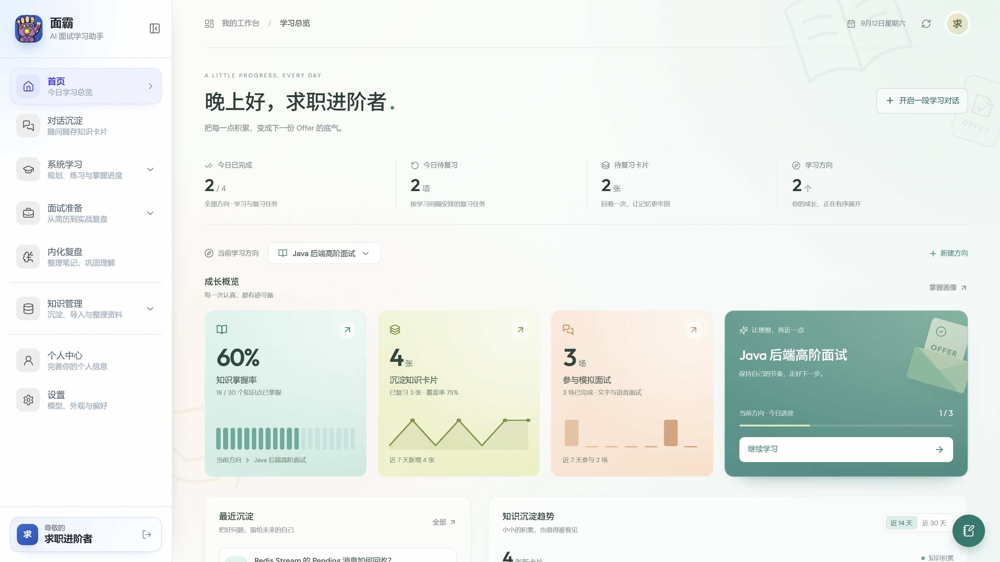
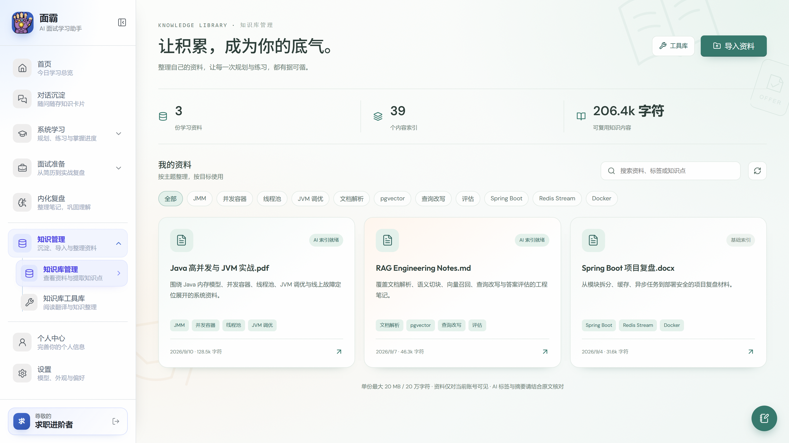
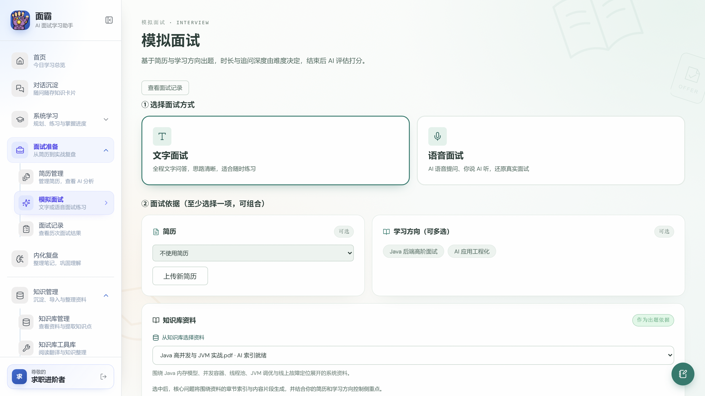

<div align="center">


# 面霸

**AI 学习 / 面试备考平台 —— 把「教学决策权」从 LLM 手里拿回来**

> 学什么、多难、何时复习、能否进下一题 —— 这四个决策一律不进 Prompt。
> LLM 只是教具：出题、评分、讲解、追问。

**🌐 立即体验:[https://mianba.vip/app](https://mianba.vip/app)**


---

[这是什么](#-这是什么) · [快速上手](#-快速上手) · [功能与使用](#-功能与使用) · [核心主张](#-核心主张) · [特性](#-特性) · [路线图](#-路线图) · [下载](#-下载) · [开发者](#开发者)

</div>

---

## 💡 这是什么

访问我们的官网： [mianba.vip](https://mianba.vip)
「面霸」是一个**学习型面试 Agent**:它不满足于"给你一堆题让你刷",而是像一位老师一样 —— 知道你学到了第几层、该复习什么、没搞懂就不许往前走。

它同时面向**学习**和**面试**两个场景:

| 模式 | 场景 | 特征 |
|---|---|---|
| **LEARN · 学习模式** | 日常学习 / 备考 | 先教后考:知识点拆解 → 逐子点讲解 → 对话式作答 → 理解型判分 |
| **REHEARSAL · 模拟面试** | 面试前冲刺 | 闭卷、强制倒计时、提交后不可编辑、追问封顶 2 轮 |
| **INTERVIEW · 完整面试** | 面试演练 | 选面试方式 / 依据(简历 + 学习方向)/ 难度 / 题数,逐题问答并逐题回顾 |

当前图谱种子方向:Java 后端(JVM / 并发 / Spring / 数据库 / 分布式 / 网络),知识图谱按 `layer 1→5` 由浅入深(概念 → 机制 → 实现 → 权衡 → 故障),可通过「新建方向」扩展到任意领域。

| 学习首页 | 知识库 | 模拟面试 |
|:---:|:---:|:---:|
|  |  |  |

## 🚀 快速上手

1. **打开面霸并登录**：浏览器访问 [mianba.vip/app](https://mianba.vip/app)，或从下方下载桌面客户端，注册并登录账号。
2. **配一个模型 Key**:进入「设置 → 模型」,选 Provider(DeepSeek / 通义千问 / Kimi),粘贴你自己的 API Key,点「**获取模型**」实时拉取模型清单选择。面霸不提供共享 Key——**你用你自己的,额度自己掌握**(桌面端的 Key 只存本机,不上传)。
3. **新建学习方向**:首页点「新建方向」——可以从你上传的资料出发,也可以用「知识图谱锻造」一句话生成概念树(可审核、可编辑再入库)。
4. **开始今日任务**:系统每天自动排"复习多少、新学多少";进入知识点先读讲解(先教),再对话式作答(后考),没搞懂闸门不放行。
5. 有问题随时用「**对话沉淀**」问,聊完一键存成知识卡片,当天进复习。

## 📖 功能与使用

| 功能 | 怎么用 | 它为你解决什么 |
|---|---|---|
| **学习计划** | 新建方向后自动生成;可增删改任意知识点 | 知识按 主题 × 层级(概念→机制→实现→权衡→故障)组织,看得见自己的版图 |
| **图谱锻造** | 新建方向时选「从知识图谱锻造」,一句话出整棵概念树,审核修剪后入库 | 冷启动不再靠手填;已有方向也能随时追加锻造(自动去重只补增量) |
| **练习(核心)** | 「今日任务」点开即练;讲解 → 作答 → 评分 → 讲解闭环 | 先教后考、7 种题型轮换、没懂不放行,拒绝"刷完就忘" |
| **掌握画像** | 侧栏「掌握画像」 | 一眼看清每个主题你掌握到第几层 |
| **对话沉淀** | 侧栏「对话沉淀」随便问 | 固定五段式精炼回答;一键存卡片,当天进复习 |
| **知识卡片** | 沉淀自动进「内化复盘」 | 随手问答不再流失;FSRS 安排到期复习 |
| **模拟面试** | 「模拟面试」两种模式 | REHEARSAL 闭卷限时冲刺;INTERVIEW 完整演练逐题回顾 |
| **简历分析** | 上传简历 | 结合简历与学习方向的面试演练依据 |
| **设置** | 主题(白天/黑夜/跟随系统)、字号、模型、学习提醒 | 全部即时生效 |

## 🎯 核心主张

现有 AI 学习工具的一切毛病,根源是**把「当老师」这件事交给了 LLM**。LLM 没有你的长期状态、不知道你的知识边界,也没有动机拦住你说"这题你还没懂,不许走",它只有"生成下一段合理文本"的本能。

> **教学决策权归服务端的确定性算法,LLM 降级为教具。**

| 决策 | 归属 | 实现 |
|---|---|---|
| 学什么 | 服务端 | 知识图谱分层选点 + 选题闸门 |
| 多难 | 服务端 | layer 难度刻度(1–5) |
| 何时复习 | 服务端 | FSRS 间隔排程 |
| 能否进下一题 | 服务端 | 掌握闸门(一题一闭环) |
| 题目文本 / 评分 / 讲解 | LLM | 多 Provider(BYOK) |

凡是能算清楚的(选哪题、分怎么算、闸门怎么拦、间隔多久、要不要去重),**一律不进 Prompt**。

## ✨ 特性

**学习闭环**

- 🧭 **学习方向** —— 从资料或知识图谱锻造创建,概念按 layer 1–5 组织成知识矩阵
- 📖 **先教后考** —— 知识点拆成 3–8 个子知识点,逐个**讲解再做题**;讲解流式生成,支持 Markdown / 代码高亮 / Mermaid 图,缓存重练不重复调模型
- 💬 **讲解页答疑** —— 读讲解时随时提问,可选中某段作为上下文,结合你自己的资料回答
- 🔗 **组合题挂靠学习** —— 新知识点挂到已掌握的锚点上练,防止一上来就崩
- 🔁 **7 种认知探针题型轮换** —— RECALL / CLOZE / REVERSE / TRAP / SCENARIO / CONTRAST / INTEGRATION
- 🗓️ **今日任务** —— 每天自动排期,题目异步预生成,READY 即秒开

**作答与判分**

- 💬 **对话式作答** —— 像聊天一样逐轮回答;中途可看答案(评分只取看答案前的部分)
- 🧑‍🏫 **理解型判分** —— 只评实际被问到的内容;看意思不看措辞,换种说法意思对即命中
- 🚪 **掌握闸门** —— 没搞懂就不会被下一题淹没(物理唯一约束)
- 🗣️ **REHEARSAL 模拟面试** —— 闭卷 + 强制倒计时 + 不可编辑,面试真实压力感

**沉淀与工具**

- 🧾 **对话沉淀** —— 自由问答(五段式精炼格式)→ 一键成知识卡片 → 当天到期复习,复习反馈回写掌握度
- 🃏 **知识卡片** —— 标签筛选 / 搜索 / 分页,两级查看答案
- 🧠 **内化复盘** —— AI 只做 critique 与思路口诀,不替你写笔记正文
- 🎙️ **INTERVIEW 完整面试** —— 方式 / 依据(简历+方向)/ 难度 / 题数 + 逐题回顾

**平台**

- 🔌 **多 Provider BYOK** —— DeepSeek / 通义千问 / Kimi;支持「获取模型」实时拉清单;桌面端 Key 只存本机
- 🖥️ **桌面应用** —— Windows / macOS;托盘驻留、学习提醒、自动更新
- 🌓 **外观** —— 白天 / 黑夜 / 跟随系统,四档字号

## 🩺 痛点解决进度

> 这个项目的出发点,是下面 7 个用 AI 学面试时真实踩过的坑。

图例:✅ 已落地 · 🟡 部分落地 · ⏳ 规划中

| # | 痛点 | 解法 | 进度 |
|---|---|---|---|
| 1 | **信息茧房**:AI 只重复你已知的名词 | 分层图谱从底层未掌握点起步;组合题挂靠锚点;每日预生成新题 | ✅ |
| 2 | **复习形式单一** | FSRS 间隔排程 + 7 种探针题型强制轮换 + 组合对比题 | ✅ |
| 3 | **无法量化水平** | 摸底对话 + mastery 0–3 + 掌握画像(每主题到第几层) | ✅ |
| 4 | **面试 ≠ 手写** | REHEARSAL 闭卷限时 + INTERVIEW 完整演练逐题回顾 | 🟡 语音口述规划中 |
| 5 | **应接不暇**:没懂就推下一题 | 掌握闸门(一题一闭环,物理唯一索引) | ✅ |
| 6 | **题型单一** | 问答(理解型判分)/ 选择(精确比对)已落地;结构化 / 算法题规划中 | 🟡 |
| 7 | **笔记不过脑子** | 内化复盘(AI 不代写正文)+ 对话沉淀成卡 + 当天到期 | 🟡 挖空自测规划中 |

## 📥 下载

| 平台 | 地址 | 说明 |
|---|---|---|
| 💻 Web(免安装) | [mianba.vip/app](https://mianba.vip/app) | 浏览器直接用 |
| 🖥️ Windows | [GitHub Releases](https://github.com/mianba-vip/mianba/releases/latest) → `mianba-cloud-win-x64.exe` | 推荐 .exe 安装版，支持自动更新；也提供 ZIP 版 |
| 🍎 macOS | [GitHub Releases](https://github.com/mianba-vip/mianba/releases/latest) → `mianba-cloud-mac-*.dmg` | Apple 芯片选 `arm64`，Intel 芯片选 `x64`；未公证时首次右键打开 |
| 📱 Android | 暂不提供公开 APK 下载 | 移动端由私有仓库维护，当前可使用网页版 |

桌面端安装后:登录 → 设置里配 Key(只存本机)→ 与 Web 端数据完全互通。

## 🗺️ 路线图

| 阶段 | 内容 | 状态 |
|---|---|---|
| P0–P5 | 地基 → 出题判分 → 闸门画像 → 间隔排程 → 模拟面试 → 内化 | ✅ 全部完成 |
| 已追加 | 先教后考 / 对话沉淀 / 知识卡片 / 完整面试 / 理解型判分 / 图谱锻造 / 桌面双模式 | ✅ |
| 规划中 | 🗣️ 语音口述 SPEAK · 🧩 结构化/算法题判分 · 🃏 概念卡片挖空自测 · 🧠 Elo/CAT 自适应 | ⏳ |

## 开发者

上面的使用说明面向线上服务和正式客户端。本公开仓库用于展示后端架构，保留模块骨架、接口契约及部分通用代码。
学习规划、练习出题与判分、AI 编排及提示词、知识锻造、持久化等完整实现由维护者在私有仓库维护。
**克隆本仓库不能部署或运行完整产品**；如果你只是想使用面霸，请访问网页版或下载正式客户端。

### 公开代码范围

- Java 21 / Spring Boot 4 的 Gradle 工程结构。
- `studyplan`、`drill`、`corpus`、`knowledge`、`interview`、`resume`、`project`、`user` 的模块分层与服务接口。
- 统一响应、业务异常、文本处理、文件哈希与文本清洗等通用实现，以及部分资料 DTO。
- 使用固定假数据的示例接口；学习和练习的占位入口固定返回 HTTP 501，不执行核心业务。

生产部署配置、基础设施地址、真实数据、数据库迁移和内部测试不包含在公开代码中。

### 查看和运行架构示例

需要 JDK 21，不需要数据库、Redis 或模型密钥：

```bash
./gradlew :app:test
./gradlew :app:bootRun
```

Windows 使用 `gradlew.bat`。示例默认只监听 `127.0.0.1:8080`。

| 示例入口 | 行为 |
| --- | --- |
| `GET /api/showcase` | 返回展示范围，`coreAvailable=false` |
| `GET /api/corpus/examples` | 返回固定假数据 |
| `POST /api/study-plans` | HTTP 501，核心学习实现未公开 |
| `POST /api/drill/runs` | HTTP 501，核心练习实现未公开 |

进一步阅读：[模块架构](docs/architecture.md) · [公开范围与历史说明](docs/public-scope.md) · [接口示例](docs/interfaces.md)。

### 发布与提交历史

正式桌面客户端由私有流水线构建并发布到本仓库的 Releases；Android APK 保持私有发布。
新的安装包发布标签仅包含版本说明和版本元数据，GitHub 自动生成的 Source code 压缩包不包含完整产品源码。
本仓库分支中的架构示例与正式客户端使用的完整实现分别维护。

为保护核心实现和部署信息，公开历史已裁剪；原有作者、时间和真实开发事件保留，受影响的提交哈希已经改变。
部分历史提交不再包含公开代码差异，`Public history record` 序号用于保留裁剪后内容相同的不同开发事件。
维护公开内容时，请仅提交审查过的文件并更新 `public-files.txt`，不要合并私有仓库的完整开发历史。

### 许可证

本仓库公开代码沿用 [GPL-3.0](LICENSE)。
