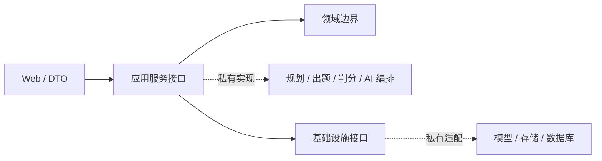

# 模块架构

| 模块 | 公开内容 | 私有内容 |
| --- | --- | --- |
| studyplan | 请求、视图、服务契约和不可用占位 | 学习规划、知识拆解、复习与进度策略 |
| drill | 请求、视图、服务契约和不可用占位 | 出题、追问、判分、反馈与调度 |
| corpus | 资料 DTO 与假数据示例 | 文档解析、索引与检索策略 |
| knowledge | 服务边界 | 知识处理和生成逻辑 |
| interview | 会话契约 | 真实面试编排和评估 |
| resume / project | 服务边界 | 解析、分析和模型调用 |
| user | 用户视图边界 | 身份认证、管理和真实用户资料 |

每个模块用 `web / dto / service / domain / repository` 表达职责。
空的领域和仓储包通过 `package-info.java` 保留层次，不提供生产实现。
通用组件只处理通用响应、文本与哈希，不包含学习或练习规则。
